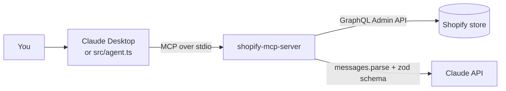

# Shopify MCP Server

A TypeScript [Model Context Protocol](https://modelcontextprotocol.io) server that connects Claude to a Shopify store. Claude can search products, check inventory, draft better product copy with the Claude API, and save it back to Shopify, but only after a human approves the change.

It also includes a **standalone command-line agent** (`src/agent.ts`) that runs the same tools through the Claude API directly. It handles the tool-use loop, multi-turn context and structured output in code, without Claude Desktop.

> My first LLM project. Built over a weekend to learn tool use, structured outputs and MCP by shipping something real.

## What it does



| Tool                        | What it does                                                                                                                                    | Writes? |
| --------------------------- | ----------------------------------------------------------------------------------------------------------------------------------------------- | ------- |
| `get_shop_info`             | Store name, domain, currency (connection check)                                                                                                 | No      |
| `count_products`            | Total number of products                                                                                                                        | No      |
| `search_products`           | Search by keyword, tag, type or status, with pagination                                                                                         | No      |
| `get_product`               | Full details for one product, including every variant                                                                                           | No      |
| `check_inventory`           | Flags low-stock and out-of-stock variants, store-wide or per product                                                                            | No      |
| `draft_product_description` | Calls Claude with a **structured output schema** to draft a title, HTML description and SEO fields. Returns the current copy next to the draft. | No      |
| `save_product_description`  | Writes approved copy with the `productUpdate` mutation. Requires `confirm: true` and is marked `destructiveHint`.                               | **Yes** |

### Example conversation (Claude Desktop)

> **You:** What's out of stock?
> **Claude:** _(calls `check_inventory`)_ The Out of Stock Snowboard and all four Gift Card variants are at 0…
> **You:** Draft a punchier description for the snowboard.
> **Claude:** _(calls `draft_product_description`)_ Here's the current copy and a draft… Want me to save it?
> **You:** Looks good, save it.
> **Claude:** _(calls `save_product_description`)_ Saved. Shopify confirms the new title, description and SEO fields.

## How to run it

**Requirements:** Node 20.12+, a Shopify Partner account, an Anthropic API key (only needed for drafting and the agent).

### 1. Shopify setup

1. In the **Shopify Dev Dashboard**, create a dev store from the **Dev stores** page. A store created from the Shopify admin isn't in your organization, and auth will fail with `shop_not_permitted`.
2. Create an app with scopes `read_products,write_products,read_inventory`. **Release** a version and **install** it on the dev store.
3. Copy the app's **Client ID** and **Client secret** from its Settings page.

### 2. Install and configure

```bash
git clone https://github.com/Rojibyte/shopify-mcp-server.git
cd shopify-mcp-server
npm install
cp .env.example .env   # fill in your values
npm run build
```

### 3. Try it

- **MCP Inspector** (test tools one by one): `npm run inspect`
- **Command-line agent:** `npm run agent`
- **Claude Desktop:** Settings → Developer → Edit Config, then add:
  ```json
  {
    "mcpServers": {
      "shopify": {
        "command": "node",
        "args": ["/absolute/path/to/shopify-mcp-server/dist/index.js"]
      }
    }
  }
  ```
  Fully quit and restart Claude Desktop afterwards.

## Design decisions

- **Auth uses the client credentials grant.** Since January 2026, Shopify no longer lets you create custom apps in the admin, so there's no permanent `shpat_` token to copy. The server exchanges the Client ID and secret for a 24-hour token, caches it, refreshes it 5 minutes before expiry, and shares one in-flight request when several tool calls arrive at once.
- **stdout belongs to the protocol.** With the stdio transport, stdout carries JSON-RPC messages, so all logging goes to stderr. `.env` is loaded with Node's built-in `process.loadEnvFile`, because some `dotenv` versions print to stdout.
- **Errors are reported, not thrown.** Tools return `isError: true` results, so Claude sees the message and can explain it or retry. Shopify's OAuth errors come back as HTML pages, so the server parses out the error code and adds a fix hint.
- **Lean tool output.** Everything a tool returns goes into the model's context window. `search_products` returns a compact summary, and `get_product` returns the full details.
- **Structured output for drafts.** `draft_product_description` uses `messages.parse()` with `zodOutputFormat(DraftSchema)`. The API constrains the reply to the schema, and the SDK hands back a typed object, so there's no free-text JSON parsing. Soft limits like SEO length come back as `warnings` instead of failures.
- **Guarding against prompt injection and hallucination.** Product data is wrapped in `<product>` tags and treated as untrusted data. The system prompt forbids inventing facts that aren't in the data.
- **Human in the loop, in layers.** Drafting never writes to the store. Saving requires `confirm: true` and is annotated `destructiveHint`. The CLI agent adds a **hard approval gate in code**: destructive tools need `y` typed in the terminal before they run.

## The agent loop (`src/agent.ts`)

1. Connects to the server as an **MCP client** and converts its tool list to Claude API tool definitions.
2. Sends the conversation and tools to Claude. While `stop_reason` is `tool_use`, it runs each requested tool through MCP and sends the results back as `tool_result` blocks. It stops at 10 steps as a safety limit.
3. Keeps the full `messages` history across turns. The API is stateless, so follow-ups like "tell me more about the first one" only work because the history is re-sent each time.
4. Final answers are constrained to a `ReplySchema` (`answer`, `products`, `nextSteps`) with structured outputs. The schema applies to Claude's text, not its tool calls.

## What broke (and what I learned)

- **`app_not_installed` (400).** Creating an app in the Dev Dashboard doesn't install it on the store. Shopify's error was an HTML page, which is why I added error-code parsing.
- **TypeScript can't check API responses.** In my hand-written `count_products` tool, the GraphQL query and its response type got out of sync and it still compiled. A response type is a promise you make, not something TypeScript verifies.
- **"Variable `$product` was not provided."** I passed the mutation but not the variables object. GraphQL variables travel separately from the query text, like a parameterised SQL query.
- **HTTP 200 doesn't mean the save worked.** `productUpdate` reports validation failures in `userErrors` with a 200 response. Without checking it, a rejected save looked like a success. I confirmed this with a 300-character title.
- **My "empty title" test didn't test anything.** The MCP Inspector leaves blank optional fields out entirely, so Shopify received _no_ title, not an empty one, and kept the old title. Validation is now `.trim().min(1)`, and I test the error path with a value Shopify actually rejects.
- **`destructiveHint` didn't trigger an approval prompt in Claude Desktop.** Annotations are hints, and the client decides what to do with them. That's why the CLI agent enforces approval in code.
- **Gift cards showed up as out of stock.** Real data surfaced a false positive: digital gift cards track inventory at 0. See below.

## What I'd do differently

- **Sanitize the HTML.** I would create allowed tags for the descriptionHtml by doing this, It will flag and remove unnecessary tags (script, img, links) those tags which can cause anything from broken layouts to a security hole.
- **Backup or Revision History.** I would add in a backup or revision history based on my experience from CMS platforms like Duda and Webflow. Adding Revision History lets me rollback to a previous version if the newly published version has some content that got added that I didn't want or I want to rollback to a previous version.
- **How the build went.** As I didn't have experience in GraphQL and MCP. I did some hands-on coding myself to understand how query and mutations works. I noticed that if I did a query working in a GraphiQL first then write a tool, I could've saved some time. As I keep building tools or MCPs, I can gradually improve my workflow.
- **Add Automated Test.** I've thought of adding an Automated test, I got this idea from an In an n8n flow I built, a form submission sent audio via webhook → transcribed it → checked for slurs → saved to PostgreSQL → displayed the result. I tested steps like the slur check with fixed sample data. I'd do the same here: use a fake Shopify client to test the guardrails automatically, so the HTML sanitizer strips `<script>`, saves without `confirm` are rejected, and `userErrors` come back as errors instead of a false success.

## Tech

TypeScript · Node.js · `@modelcontextprotocol/sdk` · zod · Anthropic TypeScript SDK (`claude-sonnet-5-5`) · Shopify GraphQL Admin API (2026-10)
